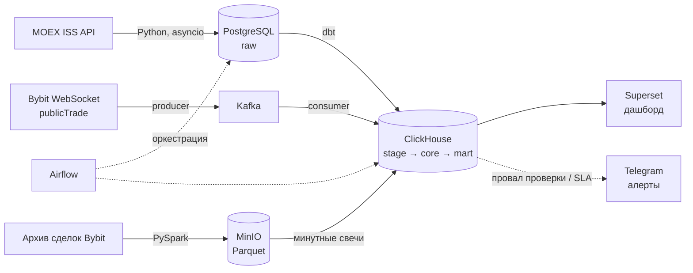

# Мониторинг аномалий на рынках

Учебный Data Engineering проект: ежедневная поставка данных Московской биржи в хранилище и автоматический отчёт о нестандартной торговой активности по акциям. В v4 добавляется внутридневной контур — поток публичных сделок криптобиржи Bybit через Kafka.

> **Статус:** в разработке. Техническое задание и архитектура готовы, идёт реализация v1 (загрузка в raw-слой). План версий — в разделе [Roadmap](#roadmap).

Проект про **инженерную поставку данных**, а не про анализ рынка: правила и пороги аномалий зафиксированы в ТЗ и не подбираются. Задача — надёжно, идемпотентно и в срок доставить данные под эти правила.

---

## Зачем это нужно

Проект моделирует первичный отбор в мониторинге рынка: участники торгов обязаны отслеживать свои операции, а биржа выявляет нестандартные сделки. В публичных данных нет заявок клиентов, поэтому система ищет не нарушителей, а **бумаги, по которым стоит проверить торги**.

| Потребитель | Вопрос | Что получает | Когда |
|---|---|---|---|
| Специалист по мониторингу | По каким бумагам вчера была нестандартная активность? | Витрина `mart_anomalies_daily` — срабатывания правил R1–R4 | до 09:00 МСК следующего торгового дня |
| Руководитель / риск-менеджер | Как чувствует себя рынок и много ли аномалий? | Дашборд в Superset | до 09:00 МСК следующего торгового дня |
| Специалист по мониторингу (v4) | Где прямо сейчас всплеск оборота? | Таблица `intraday_alerts` — срабатывания R5 по парам Bybit | не позже 2 минут после закрытия минутной свечи |

---

## Архитектура

Пунктиром показано управление и алерты, сплошными линиями — поток данных. Контур Bybit (Kafka, MinIO, Spark) появляется только в v4.

**Стек:** Python (asyncio, aiohttp, pytest) · PostgreSQL · ClickHouse · dbt · Airflow · Superset · Kafka · PySpark · MinIO · Docker Compose · GitHub Actions

---

## Источники данных

| Данные | Источник | Частота |
|---|---|---|
| Дневная история торгов акций режима TQBR | MOEX ISS, `history/.../boards/TQBR/securities.json` | раз в день + backfill |
| Справочник акций TQBR | MOEX ISS, `.../boards/TQBR/securities.json` | раз в день (снимок) |
| Минутные свечи бумаг индекса IMOEX | MOEX ISS, `.../securities/{SECID}/candles.json` | раз в день |
| Дивиденды | MOEX ISS, `securities/{SECID}/dividends.json` | раз в неделю |
| Состав индекса IMOEX | MOEX ISS, раздел statistics | раз в неделю |
| Поток публичных сделок, спот (v4) | Bybit WebSocket, топик `publicTrade.{symbol}` | непрерывно |
| Минутные свечи, спот (v4) | Bybit REST `/v5/market/kline` | догрузка и сверка раз в час |
| Архив сделок, спот (v4) | `public.bybit.com/spot/` | однократный backfill с 2025-01-01 |

Все источники доступны **без ключей и регистрации**: данные ISS бесплатно отдаются с задержкой 15 минут, публичные топики Bybit не требуют аккаунта.

Особенности, учтённые в проекте:
- Отдельного торгового календаря в ISS нет: торговый день — это день, за который в дневной истории есть сделки.
- Метод дивидендов отдаёт дату закрытия реестра, а не дату отсечки; день отсечки вычисляется по правилу режима T+1.
- Ответы ISS постраничные (курсор и параметр `start`).
- WebSocket Bybit закрывается без пинга; сделки, прошедшие за время обрыва, повторно не приходят — пропуск ловит проверка согласованности потока.

---

## Слои хранилища

PostgreSQL — зона приёма сырых данных (raw), ClickHouse — хранилище (stage, core, mart), преобразования — в dbt.

| Объект | Слой · СУБД | Зерно | Содержимое |
|---|---|---|---|
| `raw_history_daily` | raw · PostgreSQL | дата × бумага | дневная история как в ответе ISS + `loaded_at` |
| `raw_securities_snapshot` | raw · PostgreSQL | дата снимка × бумага | справочник бумаг на дату загрузки |
| `raw_candles_1m` | raw · PostgreSQL | бумага × начало свечи | минутные свечи бумаг IMOEX |
| `raw_dividends`, `raw_imoex_composition` | raw · PostgreSQL | бумага × дата | дивиденды; состав индекса |
| `raw_trades_bybit` (v4) | raw · ClickHouse | сделка | сделки из Kafka, TTL 30 дней |
| `stg_*` | stage · ClickHouse | как в raw | типизация, переименование, удаление дублей |
| `dim_security` | core · ClickHouse | бумага × версия | **SCD2** по SHORTNAME, LOTSIZE, LISTLEVEL: `valid_from`, `valid_to`, `is_current` |
| `dim_trading_day` | core · ClickHouse | дата | торговые дни из дневной истории |
| `fct_trades_daily` | core · ClickHouse | дата × бумага | цены, оборот, число сделок, дневная доходность |
| `fct_candles_1m` | core · ClickHouse | рынок × инструмент × начало свечи | минутные свечи MOEX и Bybit, партиции по месяцу |
| `ref_dividend_events` | core · ClickHouse | бумага × дата реестра | дата реестра, последний день с дивидендом, день отсечки |
| `mart_security_norms` | mart · ClickHouse | дата × бумага | нормы за 20 торговых дней для правил |
| `mart_anomalies_daily` | mart · ClickHouse | дата × бумага × правило | отчёт для мониторинга |
| `mart_market_overview` | mart · ClickHouse | дата | оборот рынка, число сделок, число необъяснённых аномалий |
| `intraday_alerts` (v4) | mart · ClickHouse | рынок × инструмент × минута | срабатывания R5 |

**Принятое упрощение:** исторических составов индекса IMOEX в открытом доступе нет, поэтому последний снимок состава применяется ко всей истории с 2025-01-01. При пересмотре индекса новые бумаги догружаются за всю историю.

---

## Правила мониторинга

Окно нормы — 20 предыдущих торговых дней бумаги (текущий день не входит). Сравнение с порогом везде строгое: равенство не срабатывает.

| Код | Правило | Условие срабатывания |
|---|---|---|
| R1 | Всплеск оборота | оборот за день > 3 × средний оборот за окно |
| R2 | Нестандартное движение цены | \|доходность\| > 3 × стандартное отклонение доходности за окно |
| R3 | Концентрация оборота перед закрытием | доля оборота последних 30 минут основной сессии > 0,4 (только IMOEX) |
| R4 | Оживление неликвидной бумаги | среднее число сделок за окно < 100 и число сделок за день > 5 × это среднее |
| R5 (v4) | Внутридневной всплеск | оборот минутной свечи > 10 × средний оборот минутной свечи за 20 дней |

Падение цены в день дивидендной отсечки, сработавшее по R2, остаётся в отчёте с пометкой `is_explained = true` (причина `dividend_gap`).

Корректность правил проверяется на подготовленных наборах (dbt seeds) с граничными случаями: значение ровно на пороге, недостаточная история, день без сделок внутри окна, дата реестра в выходной.

---

## Качество данных и SLA

**SLA:** витрины за предыдущий торговый день построены до 09:00 МСК. Нарушение SLA и провал критичной проверки сразу уходят алертом в Telegram.

| Проверка | Условие | Уровень |
|---|---|---|
| Свежесть | дневная история за предыдущий торговый день загружена до 08:00 | критично |
| Полнота дня | число бумаг за день ≥ 90% среднего за 5 предыдущих торговых дней | критично |
| Уникальность | нет повторов ключей в фактах и в `raw_trades_bybit` | критично |
| Допустимость цен | LOW ≤ OPEN, CLOSE ≤ HIGH; оборот и число сделок ≥ 0 | критично |
| Справочник | у каждой бумаги из фактов есть версия в `dim_security` на дату факта | критично |
| Полнота свечей | у бумаги IMOEX свечи есть минимум за 50% минут основной сессии | предупреждение |
| Согласованность | сумма оборота минутных свечей не больше дневного оборота более чем на 1% | предупреждение |
| Свежесть потока (v4) | последняя сделка в `raw_trades_bybit` не старше 5 минут | критично |
| Согласованность потока (v4) | свечи из потока сходятся с REST kline в пределах 1% | предупреждение |

---

## Инженерные требования

- **Идемпотентность.** Повторная загрузка любой даты или диапазона не создаёт дублей ни в одном слое.
- **Backfill.** Загрузка произвольного диапазона дат одной командой или через параметры DAG.
- **Бережная нагрузка на источник.** Не больше 5 запросов в секунду к ISS; при ошибке — до 3 повторов с растущей паузой.
- **Ресурсы.** Стек работает на ноутбуке с 8 ГБ RAM: лимиты памяти в docker-compose, сервисы сгруппированы профилями по версиям.
- **Права доступа.** Роль `loader` пишет только в raw, `transformer` читает raw и пишет stage / core / mart, `bi` только читает mart — в PostgreSQL и ClickHouse.
- **Секреты.** Пароли и токены — в `.env`, вне репозитория.
- **At-least-once для потока (v4).** Consumer коммитит offset только после успешной записи; повторная доставка не создаёт дублей благодаря уникальности по ID сделки.

---

## Roadmap

- [ ] **v1 — загрузка.** Справочник бумаг, дневная история с 2025-01-01, минутные свечи IMOEX и дивиденды → raw-слой PostgreSQL. Параллельная загрузка через asyncio, повторный запуск без дублей, pytest на разбор ответов ISS.
- [ ] **v2 — хранилище и отчёт.** Airflow по расписанию и backfill, dbt-слои stage → core → mart в ClickHouse, `dim_security` с SCD2, правила R1–R4 с тестами граничных случаев, дашборд в Superset.
- [ ] **v3 — качество и эксплуатация.** Автоматические проверки качества, алерты в Telegram (проверены искусственным сбоем), роли и права в PostgreSQL и ClickHouse, CI в GitHub Actions.
- [ ] **v4 — потоки и озеро.** Поток сделок Bybit через Kafka, сборка минутных свечей и правило R5; архив сделок с 2025 года: PySpark → Parquet в MinIO → свечи в ClickHouse; разбор перекоса нагрузки в Spark UI.

## Решения, которые будут описаны по ходу работы

- Как переносить данные из PostgreSQL в ClickHouse.
- Как реализовать SCD2: dbt snapshot или инкрементальная модель.
- Как собирать минутные свечи из потока: материализованное представление ClickHouse или задача по расписанию.

Для каждого решения здесь появится выбор и причина.

---

## Запуск

Инструкция появится вместе с v1. Цель — запуск всего стека одной командой `docker compose up`.

## Вне рамок

Данные о клиентах и заявках (их нет в открытом доступе), подбор порогов правил, объяснение причин аномалий, торговые сигналы и инвестиционные рекомендации, торговля и приватные API бирж.
